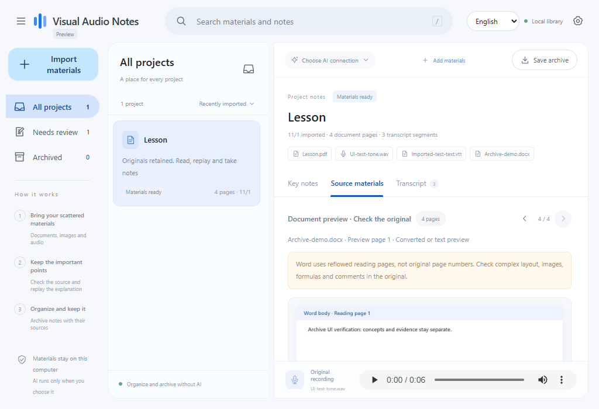

# Visual Audio Notes · 图音笔记

[English](README.md) | [简体中文](README.zh-CN.md)

Turn scattered slides, images and an independent recording into notes you can review, replay and archive.

**0.3.1 is a Windows preview, not a 1.0 stable release.** The desktop workflow is implemented; independent-material summary quality, clean Windows installations and ordinary-user trials still need validation. Tests and protocol fixtures are not accuracy scores. See the [1.0 checklist](docs/ROADMAP.md).

## Download and start

Download a Windows x64 ZIP from [v0.3.1 preview releases](https://github.com/Agnpp/visual-audio-notes/releases/tag/v0.3.1), extract the **entire folder**, and double-click **VisualAudioNotes.exe**. Keep `_internal` next to it. No Python, Node.js or CUDA setup is needed.

| Edition | Recognition setup |
| --- | --- |
| Full | Local Whisper small and RapidOCR, or your APIs. OCR is included; explicitly prepare about **486 MB** of speech weights once for offline transcription. |
| API | Your compatible speech and OCR APIs. No local recognition engines. |

1. Import documents, images and one recording together. Existing SRT/VTT is optional and reused.
2. Configure speech recognition, OCR and text summarization separately; click **Organize**.
3. Check evidence, correct terms and confirm matches only where useful.
4. **Save archive**. In English mode open `index.html` or `notes.md`; the archive works offline with its source files.

Choose **English / 简体中文** in the top bar. The choice is remembered. New AI requests use that note language; existing notes, source text and quotations remain unchanged.

[English quick start](docs/guide.en.md) · [中文使用说明](docs/guide.zh-CN.md)



## What works

- PDF, PNG/JPG and native PPTX text, tables and speaker notes. Basic DOCX/XLSX/VSDX content has labeled reading previews, with originals retained.
- WAV/MP3/M4A and existing SRT/VTT. No synchronized video, known page times or alignment answers are required.
- Local speech recognition and OCR; independent compatible speech API and DeepSeek vision OCR adapters.
- Keyword candidates without page-order/time priors. At most three suggestions, **no automatic confirmation**. Already generated AI evidence terms can assist without extra model requests.
- Topic drafts separating **recorded speech** from **document additions**, with original evidence and deferred claims retained.
- Add materials, correct text/times, stop and continue, preserve history, export Markdown and offline HTML.
- Stable API prefixes, validated step reuse, bounded requests and known/unknown usage. Online cache savings in currency are not yet established.

| No model required | Model required, local or remote |
| --- | --- |
| File copying, native text extraction, previews, existing subtitles, keyword candidates, manual notes, corrections and archive export | Speech recognition, OCR and key point summarization |

A text model is not automatically an audio or image model. The text adapter currently supports DeepSeek and a local llama.cpp service. Additional providers and chat subscriptions are not all implemented or validated; chat subscriptions are not API keys.

## Current limits

- OCR is not diagram understanding. Complex Office layout, charts, formulas, Visio semantics and legacy formats remain limited. DOCX preview pages are not Word page numbers; Excel formulas are not recalculated.
- One original recording and one user subtitle file per project; Windows x64 packages.
- Model output is a draft. Existing tests do not establish reliable concept coverage, zero factual errors or a fresh blind-evaluation pass. References locate evidence; they do not verify interpretations.
- Remote recognition uses local protocol fixtures for verification, not every online provider. Unknown usage is not zero; an in-flight request may still be billed after Stop.
- Requires system WebView2 Runtime and .NET Framework 4.x. Clean Windows, low-end devices, native picker completion and independent user trials are pending. Binaries are unsigned.

## Development

With Python 3.12 and uv installed on Windows:

```powershell
uv venv --python 3.12 .venv-desktop
uv pip sync --python .venv-desktop\Scripts\python.exe requirements-desktop.lock
& '.venv-desktop\Scripts\python.exe' 'tools\run_desktop.py'
```

Build with `tools/build_desktop.ps1 -Flavor full` or `-Flavor api`. Research models, private inputs and credentials are excluded from the repository and app.

[Contributing and tests](CONTRIBUTING.md) · [Architecture](docs/ARCHITECTURE.md) · [Release status](docs/RELEASE_STATUS.md)

## License

Project code is [MIT licensed](LICENSE). Third-party components and models retain their respective licenses, included with binary distributions. User materials and downloaded course files or weights are not relicensed by this repository.
