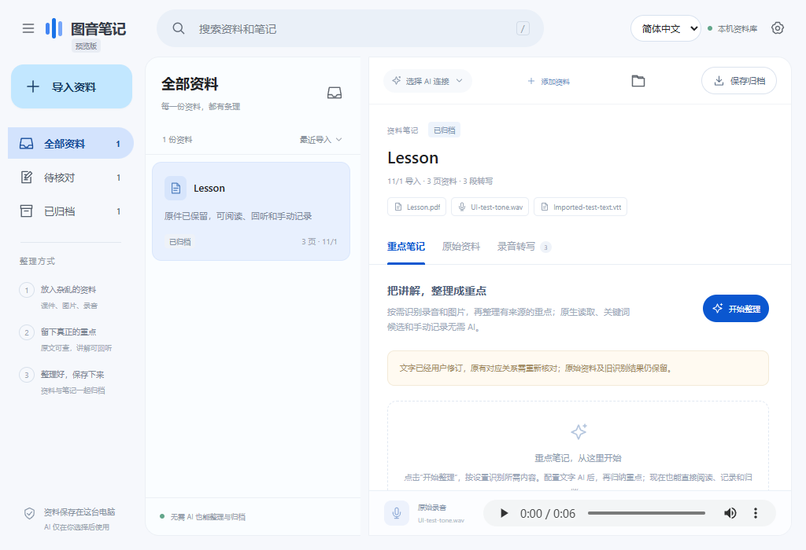

# 图音笔记 · Visual Audio Notes

[English](README.md) | [简体中文](README.zh-CN.md)

把杂乱的课件、图片与独立录音，整理成可以回看、回听、核对和长期归档的笔记。

**0.3.1 是 Windows 预览版，尚未达到 1.0 正式版标准。** 桌面流程已实现，新材料归纳质量、干净 Windows 和普通用户试用仍待验证。测试通过和协议夹具不代表模型准确率。见 [1.0 验收清单](docs/ROADMAP.md)。

## 下载与使用

从 [v0.3.1 预览版发布页](https://github.com/Agnpp/visual-audio-notes/releases/tag/v0.3.1) 下载 Windows x64 ZIP，**完整解压**，双击 **VisualAudioNotes.exe**。保留旁边的 `_internal` 文件夹，无需安装 Python、Node.js 或 CUDA。

| 版本 | 识别设置 |
| --- | --- |
| 完整识别版 | 自带本机 Whisper small / RapidOCR 引擎，也能使用 API。OCR 已随包提供，本机转写需首次明确下载约 **486 MB** 语音权重。 |
| API 轻量版 | 使用自己的兼容语音、OCR API，不包含本机识别引擎。 |

1. 一起导入课件、照片与一段录音，已有 SRT/VTT 可复用，没有也能整理。
2. 分别设置语音识别、图片识字、重点归纳，点击 **开始整理**。
3. 核对原文和原音，修正术语，只明确确认需要的对应关系。
4. **保存归档**，打开 `阅读.html` 或 `笔记.md`，资料与附件可以整体离线保存。

顶栏可切换 **简体中文 / English**，选择会保存。新 AI 请求按所选语言整理笔记；原件、引文、转写和已有笔记不会因切换语言被自动改写。

[中文快速上手](docs/guide.zh-CN.md) · [English guide](docs/guide.en.md)



## 当前已实现

- PDF、PNG/JPG、PPTX 原生文字、表格、备注；DOCX/XLSX/VSDX 基本内容与明确标记的阅读预览，原件始终保留。
- WAV/MP3/M4A、已有 SRT/VTT；不需要原视频、翻页时间或已知对应答案。
- 本机语音识别与 OCR，独立的兼容语音 API 与 DeepSeek 视觉识字适配器。
- 不依赖页序、均分时间的关键词候选，最多几页建议，**不自动确认**。已生成 AI 证据词可辅助候选，不新增模型请求。
- 有来源的主题草稿，区分 **录音讲到** 与 **课件补充**，保留原文、暂缓条目及未匹配内容。
- 同项目补加资料、文字和时间校正、停止继续、历史保留、Markdown 与离线 HTML 归档。
- 稳定 API 前缀、校验后步骤复用、调用上限及已知/未知用量；实际线上缓存节省金额尚未对照验证。

| 无需模型 | 需要模型，本机或远程均属于 AI |
| --- | --- |
| 文件复制、原生文字提取、预览、已有字幕、关键词候选、手动笔记、校正和归档 | 自动转写、OCR、重点归纳 |

文字模型不会自动获得音频或图片能力。当前文字适配器支持 DeepSeek 与本机 llama.cpp；其他供应商及聊天订阅尚未全部适配、实测，聊天订阅也不自动等于 API 凭据。

## 当前边界

- OCR 不等于理解图表或流程图。复杂 Office 排版、图表、公式、Visio 语义和旧格式尚未完整支持。Word 阅读页不是原始页码，Excel 公式不重算。
- 每项目一段原录音、一份用户字幕；当前打包平台为 Windows x64。
- AI 输出仍是草稿。现有测试不能证明关键概念覆盖可靠、事实零错误或新的盲测已通过；引用可定位也不代表解释真实。
- 远程识别用本机协议夹具验证，不能视为所有线上服务质量过关。未知用量不写零，停止后已发出的请求仍可能计费。
- 依赖系统 WebView2 Runtime 与 .NET Framework 4.x；干净 Windows、低配设备、原生选文件全流程和独立用户试用尚待验收。压缩包未签名。

## 开发

Windows 已安装 Python 3.12 与 uv 时：

```powershell
uv venv --python 3.12 .venv-desktop
uv pip sync --python .venv-desktop\Scripts\python.exe requirements-desktop.lock
& '.venv-desktop\Scripts\python.exe' 'tools\run_desktop.py'
```

用 `tools/build_desktop.ps1 -Flavor full` 或 `-Flavor api` 构建两种 ZIP。研究模型、输入原件与密钥不进入程序包或仓库。

[贡献和测试](CONTRIBUTING.md) · [架构](docs/ARCHITECTURE.md) · [发布状态](docs/RELEASE_STATUS.md)

## 许可

项目代码采用 [MIT](LICENSE)。第三方组件和模型遵循各自许可，二进制包中保留说明。用户材料、下载课件和模型权重不会因进入本项目而改变许可。
