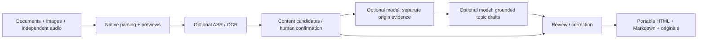

# Architecture · 架构

The desktop entry (`tools/run_desktop.py`) uses pywebview/WebView2 and a token-protected loopback server. Data is local; models are separate capabilities. / 桌面使用 WebView2 与带会话令牌的回环服务，数据本机保存，模型按能力接入。

- `desktop_store`, `desktop_prepare`, `desktop_append`: managed originals, revisions, corrections, transactional additions and restart. / 原件、版本、校正、补加与恢复。
- `recognition`, `model_assets`, `desktop_recognition`: distinct speech/OCR routes, managed weights and independent credentials. / 能力路由、模型准备、独立密钥。
- `desktop_matching`: standard-library lexical candidates; no page order or elapsed-time prior. / 标准库内容候选，不把页序和时间当答案。
- `quality`, `topic_notes`: opaque source/span IDs, exact quotations, separate audio/document origins, full claim accounting. / 不含页码时间的标识、精确引文、分来源和条目去向。
- `providers`, `step_cache`, `task_runtime`: bounded calls, stable prefixes, content/prompt/schema/validation identities and usage journals. / 受限调用、稳定前缀、校验缓存、用量日志。
- `desktop_locale`, `desktop_ui/en.json`, `i18n.js`: application labels only. Stored source text, user notes, model results and quotations are not run through UI translation. / 只本地化程序标签，不改用户内容。
- `desktop_english_archive`: English entry over the same exported sources/evidence; original-format records remain intact. / 同一批来源的英文阅读入口，原格式记录不变。

Language-specific prompts are part of cache identity. Changing note language cannot reuse a validated draft in the wrong language, while native parsing and existing recognition remain reusable. / 提示词参与缓存身份，切换笔记语言不能误用另一语言草稿，原生读取与识别仍可复用。

Research APIs, scoring inputs and original videos must stay separate. Never supply existing page/time mappings or reference answers to the matcher or summarizer. / 评分输入、原视频与模型输入隔离，不给匹配/归纳器同步答案。
